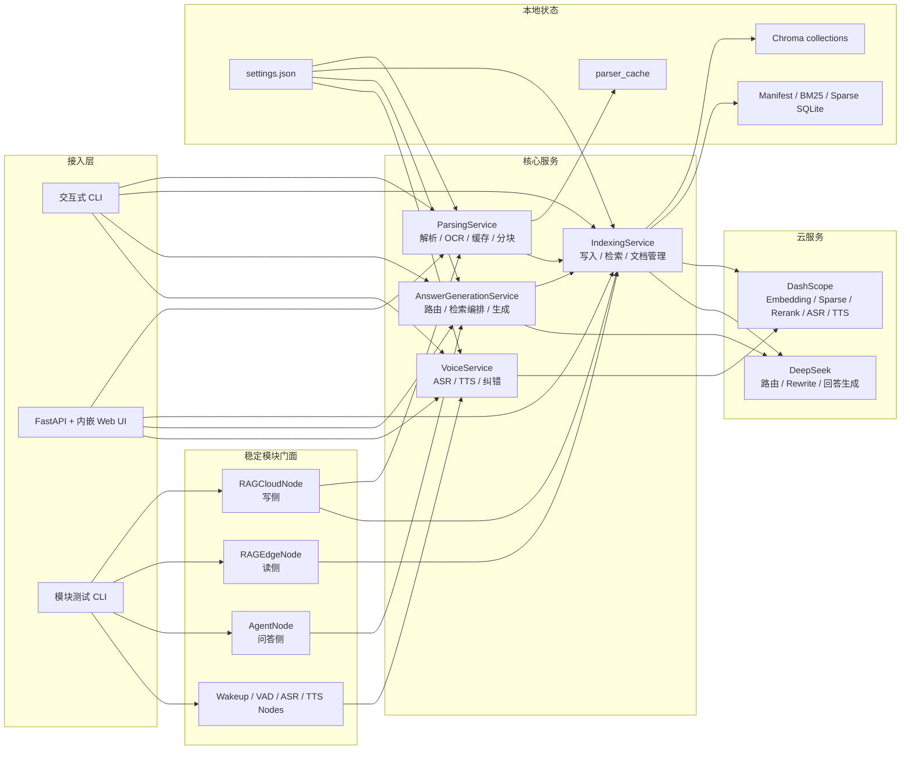
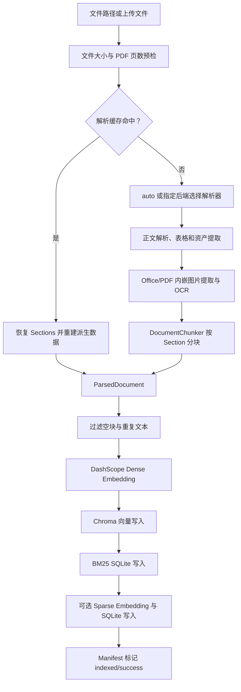
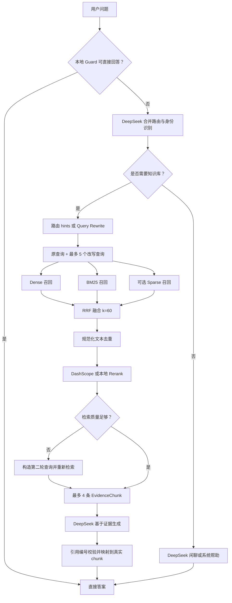

# 代码运行结论与架构说明

本文记录当前代码仓库的实际运行方式，结论以源码和测试为准。项目是一个 Python 3.10+、`src` 布局的文档 RAG 与语音交互系统；目前仍以单个 `rag-system` 包交付，但已经通过门面类和稳定数据契约划分出可独立测试、可进一步拆成 ROS2 节点的模块边界。

## 核心结论

1. 系统主链路是“文档解析 -> 分块 -> 多索引写入 -> 混合检索 -> LLM 生成 -> 引用落地”，并附带完整语音输入输出链路。
2. Web、交互式 CLI 和模块测试入口复用相同的解析、索引、问答、配置和语音服务，不存在另一套独立业务实现。
3. 文档检索不是单一路径向量搜索，而是 Dense、BM25、可选 Sparse 的多路召回，经 RRF 融合、文本去重和 Rerank 后返回结果。
4. 问答前会先执行本地保护规则，再通过一次 DeepSeek 调用合并完成意图路由和提问者身份判断。闲聊或系统帮助会绕过知识库；知识型问题才进入检索。
5. 检索质量不足时会自动执行第二轮检索。最终注入 LLM 的证据最多 4 条，模型输出的引用编号还会重新映射并校验到真实证据块。
6. 配置、解析缓存和索引持久化在 `data/`；Web 后台任务状态与对话历史保存在进程内存中。
7. 当前测试结果为 `273 passed, 8 skipped`。跳过项是必须设置 `RUN_PARSER_INTEGRATION=1` 才运行的真实解析样本集成测试。

## 总体架构



## 文档入库链路



解析编排入口是 [`ParsingService.parse_document()`](../src/rag_system/parsing/service.py)。解析器只负责把文件转换为逻辑 `ParsedSection`；缓存、分块、表格、资产、诊断和批处理由服务层统一完成。

`auto` 后端会根据文件类型、PDF 页数和扫描件判断选择轻量解析器、Docling 或 Unstructured。Docling 适合结构复杂的 PDF/Office 文档，扫描 PDF 会显式开启 OCR；大型普通 PDF 会优先使用轻量 `pypdf` 路径。

解析结果统一为 `ParsedDocument`，主要包含：

- `sections`：解析器输出的逻辑段落；
- `chunks`：可直接进入文本索引的分块；
- `tables`：HTML 或 Markdown 表格；
- `assets`：图片等视觉资产；
- `diagnostics`：实际策略、降级和非致命错误；
- `metadata`：文件哈希、大小、扩展名和 PDF 预检信息。

文本索引入口是 [`IndexingService.index_document()`](../src/rag_system/indexing/service.py)。文档 ID 为文件名与内容哈希生成的稳定 SHA-1 摘要；每个 chunk 同时进入 Dense、BM25 和可选 Sparse 存储，文档状态由 `IndexManifest` 管理。

## 检索与问答链路



核心问答入口是 [`AnswerGenerationService.answer()`](../src/rag_system/generation/service.py)，流式版本是 `stream_answer_events()`，按 `meta -> delta -> final` 输出事件。

具体检索行为：

1. 每个请求并发启动一次 Qwen Router、一次 Dense 查询向量化和一次 Sparse 查询向量化。
2. 检索固定使用清洗后的原始问题；路由的 standalone_query/rewrite_hints 仅用于诊断。
3. 单轮执行 Dense、BM25 和可用 Sparse，候选扩大为 `4 * top_k`，上限 80。
4. 各路使用 `sum(1 / (60 + rank))` 计算 RRF，随后按规范化文本去重并按 RRF、命中词和路线信息排序。
5. Dense 或 Sparse 失败时保留其他可用路线；不执行 Query Rewrite、Rerank 或第二轮检索。
6. 回答模型只能使用注入证据，证据内容被明确视为不可信文本，不能覆盖系统规则。

## 语音链路

语音能力由 [`VoiceService`](../src/rag_system/voice/service.py) 编排，并通过 Wakeup、VAD、ASR、TTS 四个稳定门面暴露：

```text
本地唤醒词检测
  -> 命中后建立 Qwen Realtime ASR 连接
  -> 云端 server VAD 或本地 FSMN-VAD 断句
  -> Qwen ASR；不可用时可回退本地 faster-whisper
  -> 简繁转换与领域词表纠错
  -> RAG 问答
  -> Qwen Realtime TTS；首个音频块前失败时回退 Edge-TTS
```

## 工控机显示链路

专用屏幕使用 Chromium kiosk 打开 `/display`。该页面是一个显示壳，默认显示 `emotion` 模式和 `idle` 表情；需要维护时通过 ROS2 `/display/set_mode` 服务切换到 `web`，无需鼠标、键盘或重启浏览器。`display_node` 订阅现有 `/voice/display_text`，将 `[query]`、`[delta]`、`[answer]` 和 `[error]` 映射为表情状态，并通过 `data/runtime/display_state.json` 与 Web 进程共享状态。工控机重启时显示节点会重新初始化为 `emotion + idle`。

持久唤醒 WebSocket 在唤醒词命中前只进行本地处理，不会把待机音频上传到云端。TTS 统一输出 MP3；流式 TTS 已经输出过 DashScope 音频后若发生错误，不会再混入 Edge-TTS 音频。

## 模块职责

| 模块 | 主要职责 | 核心入口 |
| --- | --- | --- |
| `parsing` | 多格式解析、OCR、分块、缓存、结构提取 | `ParsingService` |
| `indexing` | Dense/BM25/Sparse/图片索引、混合检索、文档管理 | `IndexingService`、`ImageIndexingService` |
| `retrieval` | Query Rewrite 与 Rerank Provider | `DeepSeekQueryRewriteClient`、`DashScopeReranker` |
| `generation` | Guard、意图与身份路由、证据构建、回答生成、历史 | `AnswerGenerationService` |
| `voice` | ASR/TTS Provider 编排、降级、文本纠错 | `VoiceService` |
| `wakeup` / `vad` / `asr` / `tts` | 独立语音模块门面 | 对应 `*Node` |
| `rag_cloud` | 文档解析、入库和删除的写侧门面 | `RAGCloudNode` |
| `rag_edge` | 搜索、文档列表和统计的读侧门面 | `RAGEdgeNode` |
| `agent` | 完整回答和流式事件的问答门面 | `AgentNode` |
| `web` | FastAPI、内嵌前端、后台任务和 WebSocket 编排 | `rag_system.web.app:app` |
| `module_test` | 模块发现、环境自检和统一测试分发 | `rag_system.module_test.cli` |
| `time_probe` | 按需采集本地模块和函数耗时 | `TimeProbe`、`rag_system.time_probe.cli` |

`RAGCloudNode`、`RAGEdgeNode` 和 `AgentNode` 主要用于隐藏内部 Provider 和存储细节，并提供稳定、JSON-ready 的输入输出。它们不是独立实现，最终仍复用核心服务。

## 运行入口

| 命令 | 行为 |
| --- | --- |
| `python -m rag_system` | 启动交互式问答 CLI，支持解析、入库、搜索、语音和自动 TTS |
| `python -m rag_system.web` | 用 Uvicorn 启动 `127.0.0.1:8000` |
| `python -m rag_system.parsing PATH` | 直接输出 sections、chunks 或完整 `ParsedDocument` JSON |
| `python -m rag_system.time_probe -- MODULE ...` | 运行目标模块并生成函数/模块耗时 JSON |
| `.\module-test.ps1 doctor` | 离线检查依赖、模型、配置和样例文件，不发起 API 请求 |
| `.\module-test.ps1 <module> ...` | 独立测试 wakeup、vad、asr、tts、rag-cloud、rag-edge 或 agent |

模块测试默认使用 `data/acceptance/index`，避免污染正式 `data/index`。

## 配置、持久化与外部依赖

默认运行状态如下：

| 路径或服务 | 内容 |
| --- | --- |
| `data/settings.json` | 模型、API 地址、Key、分块、历史、ASR/VAD/唤醒/TTS 配置 |
| `data/uploads/` | Web 上传原文件 |
| `data/parser_cache/` | SHA-256 驱动的解析 JSON 缓存 |
| `data/extracted_assets/` | 从 Office/PDF 提取的图片资产 |
| `data/index/chroma/` | `rag_chunks` 和 `rag_images` Chroma collections |
| `data/index/index.sqlite3` | 文档 manifest |
| `data/index/bm25.sqlite3` | BM25 文本、token 与 metadata |
| `data/index/sparse.sqlite3` | Sparse 向量与 metadata |
| 进程内字典 | Web 解析、文本索引、图片索引任务状态 |
| 进程内对象 | Web 全局对话历史、语音/VAD/唤醒单例 |

API Key 加载优先级是“配置文件 > 环境变量 > 未配置”。环境变量为 `DASHSCOPE_API_KEY` 和 `DEEPSEEK_API_KEY`；公共设置接口只返回是否存在、来源和掩码，不返回明文。

主要云依赖：

- DashScope：Router、文本与图片 Embedding、Sparse Embedding、实时 ASR、实时 TTS；
- DeepSeek：身份/意图兼容路由与回答生成。

解析本身可以离线运行。BM25 和已有本地索引也可离线读取；查询向量化失败时会自动降级到可用路线。

## 关键运行边界

1. `data/...` 均为相对路径，因此必须从仓库根目录启动；从其他工作目录运行会读写另一套配置和索引。
2. Web 的后台任务状态只保存在内存中，服务重启后任务 ID 和轮询进度会丢失，但已经写入磁盘的上传、缓存和索引仍存在。
3. Web 使用一个全局 `ConversationHistory`，当前不同浏览器用户会共享对话上下文，重启后清空。
4. Chroma、BM25、Sparse 和 manifest 之间没有跨存储事务；写入中途失败可能留下部分索引。Web 会记录失败状态，但不会自动回滚所有已写数据。
5. 停用文档只修改 manifest，数据仍保留在各索引中，查询阶段再过滤；删除才会实际清理索引。
6. `DocumentChunker` 允许 `chunk_overlap=0`，但当前 `_with_overlap()` 使用 `previous[-0:]`，会把整个上一块当作 overlap。这是需要修正或通过校验禁止的边界行为。
7. Web UI、CSS、JavaScript 和 API 路由全部集中在 `web/app.py`，功能完整但文件较大，后续多人维护时适合拆分静态资源与路由模块。

## 验证结论

执行命令：

```powershell
.\.venv\Scripts\python.exe -m pytest -q -p no:cacheprovider
```

结果：

```text
273 passed, 8 skipped, 1 warning
```

- 8 个跳过项属于真实解析样本集成测试，需设置 `RUN_PARSER_INTEGRATION=1`。
- 唯一警告来自 FastAPI/Starlette 测试客户端使用的 `httpx` 兼容层弃用提示。
- 单元测试已覆盖解析、缓存、OCR、索引、RRF、Rewrite/Rerank 降级、问答路由与引用、Web API、语音 Provider 和独立模块门面。
- 尚未由默认测试覆盖的重点包括跨存储部分失败回滚、多进程索引并发、真实云 API、真实 Chroma 端到端查询，以及完整客户录音的准确率与延迟验收。

## 关键源码索引

- [`src/rag_system/parsing/service.py`](../src/rag_system/parsing/service.py)：解析总编排。
- [`src/rag_system/parsing/chunking.py`](../src/rag_system/parsing/chunking.py)：分块逻辑。
- [`src/rag_system/indexing/service.py`](../src/rag_system/indexing/service.py)：文本入库与混合检索。
- [`src/rag_system/indexing/image_service.py`](../src/rag_system/indexing/image_service.py)：图片索引与检索。
- [`src/rag_system/generation/service.py`](../src/rag_system/generation/service.py)：问答主流程。
- [`src/rag_system/generation/intent_router.py`](../src/rag_system/generation/intent_router.py)：意图与身份合并路由。
- [`src/rag_system/generation/deepseek_chat.py`](../src/rag_system/generation/deepseek_chat.py)：回答 Provider 和提示词约束。
- [`src/rag_system/voice/service.py`](../src/rag_system/voice/service.py)：语音 Provider 编排。
- [`src/rag_system/web/app.py`](../src/rag_system/web/app.py)：Web API、UI 与后台任务。
- [`src/rag_system/settings.py`](../src/rag_system/settings.py)：配置加载、持久化和校验。
- [`docs/module_packages.md`](module_packages.md)：独立模块和验收入口。
- [`docs/module_testing_guide.md`](module_testing_guide.md)：逐模块运行、单元测试和故障排查指南。
- [`docs/ros2_node_design.md`](ros2_node_design.md)：计划中的 ROS2 拆分方案。
