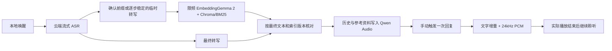

# 直接语音回复流程

本次改造将默认问答链路改为：本地唤醒 → 云端 Qwen ASR → 本地 EmbeddingGemma 2 检索 → Qwen Audio 3.1 直接输出文字和音频。无需 DeepSeek Key，不再请求轮次/意图/身份分析、问题改写、重排或单独的回复 TTS。仅保留确定性的空语音过滤、精确结束指令和唤醒/打断控制。



## 模型与配置

| 用途 | 默认配置 |
|---|---|
| 文本向量 | `google/embeddinggemma-2`，768 维、归一化 |
| 向量接口 | `http://127.0.0.1:8765/v1/embeddings` |
| 文档/查询提示词 | `Document` / `SearchQuery` |
| ASR | `qwen3-asr-flash-realtime`，16kHz 单声道 PCM16 |
| 回复 | `qwen-audio-3.1-realtime-plus`，`longanqian_v3.1` |
| 音频输出 | 24kHz 单声道、小端 PCM16 |

`data/settings.json` 中的 `embedding_url`、`audio_reply_url` 和 `audio_reply_voice` 可配置；API Key 继续使用本地设置或 `DASHSCOPE_API_KEY`。加载旧设置时，旧文本向量模型/维度和回复模型会被新契约覆盖；真实密钥和其他设置不重写。默认关闭云端稀疏向量和重排，保留本地 BM25。图片索引仍为独立功能，不参与本次语音文本检索。

Windows 启动器会先复用现有 EmbeddingGemma 2 服务；没有服务时，使用 `EMBEDDINGGEMMA_MODEL_DIR` 指定的模型服务目录。当前开发机也可复用 `F:\AI-Shared\model_test\embeddinggemma2`。自定义 `embedding_url` 时跳过本地模型自动启动，由部署方保证该地址可用。权重、CUDA 环境和服务本体不打包进仓库。

```powershell
.\.venv\Scripts\python.exe -m pip install -e ".[web,indexing,voice]"
.\.venv\Scripts\python.exe -m rag_system.model_setup download --component wakeup
.\scripts\start_embedding_windows.ps1 -ModelDir F:\AI-Shared\model_test\embeddinggemma2
.\.venv\Scripts\python.exe -m rag_system.indexing.migrate_embeddinggemma --index-dir data/index
.\scripts\start_windows.ps1 -NoBrowser
```

已有 Web 进程需要通过项目的停止/启动脚本重启后才会加载新代码。嵌入服务可能被其他项目共用，停止 Web 服务不会停止它。

## 索引迁移

新文本索引使用 `data/index/embeddinggemma2_768_v1/`，集合为 `rag_chunks__embeddinggemma2_768_v1`。旧 `data/index/chroma`、旧清单和 1024 维向量保留。

迁移从旧 Chroma 读取原始分块文字，重新生成全部向量，保留分块 ID、来源和文档启用状态，重建 BM25。成功后生成本地 `migration.json` 回执。失败时保留 `migration-in-progress.json`，服务拒绝读取不完整索引；修复模型服务后重跑相同命令可继续同一源快照。没有旧库的新安装直接通过页面解析入库。

当前开发机已迁移 1 个文档、3 个分块。这只是本机现存库的范围，不能视为完整生产语料已迁移。数据库和回执在被 Git 忽略的 `data/` 下。

## 转写与检索时序

默认 ASR 使用云端流式服务。旧的本地 Whisper 配置与云端故障回退仍作为兼容路径保留；回退时页面会收到明确的 `asr_fallback` 事件，本地整段转写无法提供同样的中间文本预取。下面的流式时序及实测数据均针对云端正常路径。

ASR 的 `confirmed_text` 和临时 `stash` 保留到客户端。对有确认前缀或共同前缀至少 4 字的逐步更新预览发起检索；每个轮次至少间隔 350ms，只允许一个在途查询和一个最新待处理查询，全局最多 4 个预取任务。

最终转写附带随机、一次性、有效期 120 秒的 `retrieval_token`。回答服务只有在最终文字与预取文字完全相同、索引及模型配置版本一致时才复用。相同文字的查询仍在执行或排队时，最终回答接续该任务，避免再次提交相同嵌入；等待支持取消，25 秒超时会报错而不并发重试。转写修正、文档变更、已结束的预取失败或令牌失效时重新检索。预取失败不会被当成空资料成功返回。临时转写不会触发回复。

Qwen 回复连接只接收转写文字、历史和最终选定资料，`turn_detection=null`。等上下文写入确认后才发送一次 `response.create`；此版本不重复发送原始用户语音。音频与文字来自同一回复；参考资料是候选证据，不伪装成模型引用。

收到最终问题后，Qwen 建连及会话配置与检索并行；预连接阶段只发送原有系统提示词，不发送临时转写，也不触发生成。每个连接只属于一次回复，全局最多 4 个提前准备的连接，容量不足时使用原本的串行建连。检索失败、取消和连接异常都会清理该轮资源，不复用其他轮次连接。回复提示词、历史上限和篇幅策略保持不变。

Web 启动阶段执行一次完整本地检索，预热嵌入接口、Chroma、分词和 BM25，完成后才接受正常请求。失败会明确记录；普通模式仍保留设置页面以便修复配置，严格模式拒绝启动。此预热不调用回复模型。

网页和机器人分别传递独立 `conversation_id`，历史不串用。打断会取消 HTTP 请求、发送 `response.cancel` 并关闭回复连接，清空 PCM 缓冲；旧轮次事件不能恢复播放。生成结束不等于播放结束：网页等待 Web Audio 的所有 buffer 结束，机器人等待 PortAudio drain，之后才继续聆听。

## ROS2 入口

完整语音入口 `ros2/voice/scripts/run_full_voice.sh` 启动/复用本地 Web 后端，再加载 `voice_realtime.launch.py`。新 `realtime_voice_gateway` 将麦克风 PCM 送到 `/api/voice/session/stream`，复用网页的唤醒、ASR、预取和回答接口，直接播放 Qwen PCM，不调用厂商 TextToAudio 生成回复。提示音使用本地预录音频，完成播放才发送 `prompt_finished`。

```bash
export RAG_DATA_DIR=/path/to/green-river/data
# 先准备本机或局域网可访问的 EmbeddingGemma 2 服务，并迁移此机器的数据。
./ros2/voice/scripts/install_linux.sh
./ros2/voice/scripts/run_full_voice.sh input_device:=0 output_device:=0
```

也可在后端已运行时执行 `ros2 launch voice voice_realtime.launch.py data_dir:=... backend_url:=http://127.0.0.1:8000`。原 `run_voice.sh` / `voice_rag.launch.py` 保留为兼容入口；它们包含厂商 TTS 与旧本地音频节点，不是新流程。新旧麦克风入口不要同时启动。

## 验证边界

后续延迟优化复测（同一合成语音、400ms 静音阈值、3 个知识分块、独立会话）：低 GPU 负载下追加 5 轮，说完到首段音频中位数从 3.66 秒降至 1.53 秒，范围 1.35–1.81 秒；回复首字从 3.04 秒降至 1.09 秒；最终转写后检索及上下文就绪从 1.30 秒降至 0.33 秒。启动预热后第一次 HTTP 检索为 443ms，原首次为 10.18 秒；本次启动脚本耗时 10.61 秒，初始化开销移到了启动阶段。

优化后的两组共 10 轮端到端请求全部成功并复用预取。第一组包含 GPU 资源竞争，保留了 6.19 秒的长尾，不能作为相同负载的严格对照；附加 Qwen 分解探针有 1 次超时，未混入端到端成功率。完整回归 412 项通过、9 项跳过；增加取消组合用例后定向 32 项通过。回复系统提示词哈希及 4356 个输入 token 核对一致，未新增字数、句数或输出 token 限制。详细对照见本地 `data/runtime/response-speed-optimization-comparison.txt`，原始两组数据分别为 `response-speed-after-optimization.json` 和 `response-speed-after-low-load.json`。这些小样本结果不代表生产 P95，首段音频到达也不等同于扬声器物理首响。

开发机实测（2026-10-19 UTC）：

- 完整 pytest：399 项通过、9 项跳过。8 项为默认未开启的重型解析集成测试，1 项因 Windows 账号不具备符号链接权限跳过 Linux 环境入口契约测试。
- 现存库迁移：1 个文档、3 个 768 维向量，原始分块 ID、文字、启用状态保留，旧库指纹复核未变。
- 真实云端 ASR：仓库合成语音样本产生 11 次中间转写、1 次最终转写；期间发起 2 次本地查询，最终回答成功复用完全匹配的预取结果。回执：`data/runtime/asr-live-smoke.json`。
- 正式 HTTP 回复入口：第一轮检索到 3 个分块，Qwen 输出 30 个文字增量、33 个音频块、618240 字节 PCM；第二轮纯文字追问成功携带 1 轮历史。回执：`data/runtime/full-chain-live-smoke.json`。这两次请求验证了同一模型的音频/纯文字模式，耗时不代表生产延迟保证。
- 浏览器模拟回复：真实 Web Audio 完成静音 PCM 播放后才结束回答，独立回复 TTS 请求数为 0；停止后队列清空、迟到音频不恢复播放。
- 已补齐本机 sherpa-onnx 运行库和经哈希校验的唤醒模型；仓库合成唤醒样本成功触发“小绿小绿”。回执：`data/runtime/wakeup-live-smoke.json`。

运行日志、模型文件、索引和测试回执均保存在 Git 忽略目录，未作为代码发布。

覆盖了本地向量契约、查询/文档前缀差异、旧库保留和禁用状态、ASR 临时转写预取、过期结果丢弃、单次消费、取消生成、缺失完成事件、PCM 排队/清空，以及机器人输出完成必须晚于设备 drain。

真实服务探针使用仓库自带的合成语音样本和简短测试问题。浏览器回归使用模拟回复及静音 PCM，验证真实 Web Audio 时序和零回复 TTS 请求。Windows 机器上无法完成 ROS2 构建、机器人麦克风/扬声器、回声、动作执行的实机验收；这些需要在机器人上运行新入口确认。

协议依据：[Qwen Audio 客户端事件](https://help.aliyun.com/zh/model-studio/fun-audiochat-client-events)、[Qwen ASR 服务端事件](https://help.aliyun.com/zh/model-studio/qwen-asr-realtime-server-events)、[EmbeddingGemma 2 模型说明](https://ai.google.dev/gemma/docs/embeddinggemma/model_card_2)。
